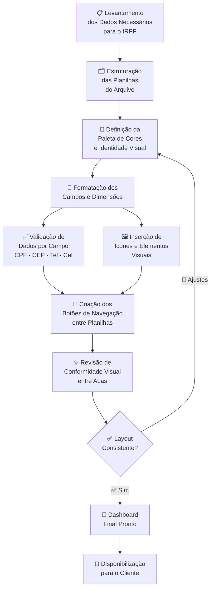

# 🧾 Organizador de Declaração de Imposto de Renda

<div align="center">


**Aplicação em Excel para coleta e organização de dados de clientes para o preenchimento da Declaração de Imposto de Renda**

[🧩 Funcionalidades](#-funcionalidades-implementadas) • [🎨 Design](#-design-e-formatação) • [✅ Validações](#-validação-de-dados) • [🔗 Navegação](#-navegação-e-botões) • [📸 Dashboard](#-dashboard-final)

</div>

---

## 📌 Sobre o Projeto

Aplicação desenvolvida em **Microsoft Excel** com o objetivo de **organizar e coletar informações de clientes** para o preenchimento adequado da **Declaração de Imposto de Renda (IRPF)**.

> O projeto combina **formatação avançada**, **validação de dados**, **navegação por botões** e **conformidade visual** entre planilhas, entregando uma experiência profissional e acessível para o usuário final.

---

## 🎯 Objetivo

Criar uma ferramenta organizada e visualmente consistente capaz de:

<div align="center">

| # | 🎯 Funcionalidade | 📋 Descrição |
|---|---|---|
| 1 | 🧾 **Coleta de Dados** | Formulário estruturado para dados do declarante |
| 2 | 🎨 **Dashboard Visual** | Painel principal com identidade visual profissional |
| 3 | ✅ **Validação de Campos** | CPF, CEP, telefone e celular com formato automático |
| 4 | 🔗 **Navegação Integrada** | Botões de link entre planilhas do arquivo |
| 5 | 🖼️ **Conformidade Visual** | Paleta de cores e layout padronizados em todas as abas |

</div>

---

## 🧩 Funcionalidades Implementadas

### 📋 Coleta de Dados do Cliente

O formulário organiza os dados necessários para a declaração em seções estruturadas:

```
┌──────────────────────────────────────────────────────────────────┐
│              🧾 DADOS DO DECLARANTE                              │
├──────────────────────────┬───────────────────────────────────────┤
│  👤 Nome Completo        │  ________________________________      │
│  🪪 CPF                  │  ___.___.___-__  (formatado)          │
│  📅 Data de Nascimento   │  __/__/____                           │
│  📍 CEP                  │  _____-___  (formatado)               │
│  🏠 Endereço             │  ________________________________      │
│  📞 Telefone Fixo        │  (__) ____-____  (formatado)          │
│  📱 Celular              │  (__) _____-____  (formatado)         │
│  📧 E-mail               │  ________________________________      │
└──────────────────────────┴───────────────────────────────────────┘
```

---

## 🎨 Design e Formatação

Foram aplicadas técnicas avançadas de formatação para garantir um layout **profissional, legível e consistente**:

<div align="center">

| 🎨 Elemento | 🖌️ Tratamento Aplicado |
|---|---|
| 🎨 **Paleta de Cores** | Cores institucionais padronizadas em todo o arquivo |
| 📏 **Dimensões** | Largura de colunas e altura de linhas ajustadas |
| 📅 **Data** | Formatação personalizada de campos de data |
| 📐 **Linhas** | Bordas e separadores visuais entre seções |
| 🖼️ **Ícones** | Ícones representativos em cada campo e seção |
| 📝 **Campos personalizados** | CPF, CEP, telefone fixo e celular com máscara |
| 🔗 **Botões de link** | Navegação entre planilhas por botões clicáveis |
| ✨ **Conformidade visual** | Padrão aplicado de forma consistente em todas as abas |

</div>

---

## ✅ Validação de Dados

Foi utilizado o recurso de **Validação de Dados** do Excel para garantir que os campos sejam preenchidos corretamente:

### 🪪 Formatação Personalizada dos Campos

| 📋 Campo | 📐 Máscara Aplicada | ✅ Exemplo |
|---|---|---|
| 🪪 **CPF** | `000.000.000-00` | `123.456.789-09` |
| 📍 **CEP** | `00000-000` | `01310-100` |
| 📞 **Telefone Fixo** | `(00) 0000-0000` | `(11) 3333-4444` |
| 📱 **Celular** | `(00) 00000-0000` | `(11) 98765-4321` |
| 📅 **Data** | `DD/MM/AAAA` | `15/03/1985` |

### 🔒 Regras de Validação

```
  📋 Campo           🔍 Regra de Validação              ⚠️ Alerta
  ─────────────────────────────────────────────────────────────
  🪪 CPF             Apenas números (11 dígitos)         ❌ Formato inválido
  📍 CEP             Apenas números (8 dígitos)          ❌ CEP inválido
  📞 Telefone        Apenas números (10 dígitos)         ❌ Número inválido
  📱 Celular         Apenas números (11 dígitos)         ❌ Número inválido
  📅 Data            Formato de data válido              ❌ Data inválida
  📋 Lista suspensa  Opções predefinidas                 ❌ Valor não permitido
```

---

## 🔗 Navegação e Botões

Foram criados **botões de link** para facilitar a navegação entre as planilhas do arquivo:

```
┌─────────────────────────────────────────────────────────────┐
│                    🔗 MENU DE NAVEGAÇÃO                     │
├──────────────┬──────────────┬──────────────┬────────────────┤
│  🏠 Início   │  👤 Dados    │  💰 Rendas   │  📊 Resumo    │
│  [  BOTÃO  ] │  [  BOTÃO  ] │  [  BOTÃO  ] │  [  BOTÃO  ]  │
├──────────────┼──────────────┼──────────────┼────────────────┤
│  🏦 Bens     │  💊 Saúde    │  🎓 Educação │  🧾 Dívidas   │
│  [  BOTÃO  ] │  [  BOTÃO  ] │  [  BOTÃO  ] │  [  BOTÃO  ]  │
└──────────────┴──────────────┴──────────────┴────────────────┘
```

| 🔗 Recurso | 📋 Descrição |
|---|---|
| 🖱️ **Botões clicáveis** | Criados com formas e hiperlinks para navegação direta |
| 🔀 **Links entre planilhas** | Cada botão redireciona para a aba correspondente |
| ✨ **Estilo padronizado** | Todos os botões seguem a mesma identidade visual |
| 📍 **Âncoras de retorno** | Botão "Voltar" disponível em cada seção |

---

## 🗺️ Pipeline de Desenvolvimento



---

## 📸 Dashboard Final

> 📌 Adicione aqui uma captura de tela do dashboard desenvolvido no Excel.

```
┌─────────────────────────────────────────────────────────────────────────┐
│  🧾  ORGANIZADOR DE IMPOSTO DE RENDA          📅 Ano-Base: 20XX        │
├─────────────────────────────────────────────────────────────────────────┤
│  🔗 [ 🏠 Início ] [ 👤 Dados ] [ 💰 Rendas ] [ 🏦 Bens ] [ 📊 Resumo ]│
├──────────────────────────────────────────────────────────────────────── ┤
│                                                                         │
│   👤 DADOS DO DECLARANTE                                                │
│   ┌───────────────────────────────────────────────────────────────┐    │
│   │  Nome:   ______________________________                       │    │
│   │  CPF:    ___.___.___-__    📅 Nasc.: __/__/____               │    │
│   │  CEP:    _____-___         📞 Tel:   (__) ____-____           │    │
│   │  📱 Cel: (__) _____-____   📧 Email: __________________       │    │
│   └───────────────────────────────────────────────────────────────┘    │
│                                                                         │
└─────────────────────────────────────────────────────────────────────────┘
```

---

## 📊 Estrutura das Planilhas

```
📦 Organizador-IRPF.xlsx
 ├── 🏠 Início              # Dashboard principal e menu de navegação
 ├── 👤 Dados Pessoais      # Formulário de dados do declarante
 ├── 💰 Rendimentos         # Salários, aluguéis e outras rendas
 ├── 🏦 Bens e Direitos     # Imóveis, veículos, investimentos
 ├── 💊 Despesas Médicas    # Gastos com saúde e plano de saúde
 ├── 🎓 Despesas Educação   # Gastos com educação e ensino
 ├── 🧾 Dívidas e Ônus      # Empréstimos e financiamentos
 └── 📊 Resumo              # Visão consolidada das informações
```

---

## 🚀 Resultados Obtidos

<div align="center">

| ✅ Resultado | 📋 Descrição |
|---|---|
| 🧾 **Formulário Completo** | Coleta estruturada de todos os dados necessários para o IRPF |
| 🎨 **Dashboard Profissional** | Layout visual padronizado com paleta de cores institucional |
| ✅ **Campos Validados** | CPF, CEP e telefones com formatação e validação automáticas |
| 🔗 **Navegação Fluida** | Botões de link facilitam o acesso a cada seção |
| ✨ **Conformidade Visual** | Identidade visual consistente em todas as planilhas |

</div>

---

## 🧰 Ferramentas Utilizadas

<div align="center">

| 🛠️ Ferramenta | 📌 Uso no Projeto |
|---|---|
|  | Plataforma principal do organizador |
|  | Máscaras de CPF, CEP, telefone e data |
|  | Regras de preenchimento por campo |
|  | Navegação entre planilhas |
|  | Paleta de cores e identidade visual |
|  | Representação visual de cada seção |

</div>

---

## 🎓 Competências Desenvolvidas

- 🧾 Organização de **formulários fiscais** em Excel
- 🎨 **Design de dashboards** com paleta de cores e identidade visual
- ✅ Implementação de **validação de dados** por campo e tipo
- 📐 Aplicação de **formatação personalizada** (máscaras de CPF, CEP, telefone)
- 🔗 Criação de **botões de navegação** com hiperlinks entre planilhas
- 🖼️ Uso de **ícones** para melhoria da experiência do usuário
- ✨ Garantia de **conformidade visual** entre múltiplas planilhas
- 👤 Foco em **usabilidade e experiência** do usuário final

---

## 🔗 Referências

- 📗 [Validação de Dados — Microsoft Excel](https://support.microsoft.com/office/aplicar-validacao-de-dados)
- 🎨 [Formatação Personalizada de Células](https://support.microsoft.com/office/criar-ou-excluir-um-formato-de-numero-personalizado)
- 🧾 [Receita Federal — IRPF](https://www.gov.br/receitafederal/pt-br/assuntos/meu-imposto-de-renda)
- 🎓 [DIO — Digital Innovation One](https://www.dio.me)

---

## 👤 Autor

<div align="center">

**Desenvolvido com 💙 — organização fiscal e modelagem avançada em Excel para facilitar a vida do contribuinte.**

[](https://www.dio.me)
[](https://github.com)
[](https://linkedin.com)

</div>

---

<div align="center">

⭐ **Se este projeto foi útil para você, considere deixar uma estrela no repositório!** ⭐

`🧾 IRPF` • `📊 Excel` • `🎨 Dashboard` • `✅ Validação de Dados` • `🔗 Navegação` • `🪪 CPF` • `📋 Formulário Fiscal`

</div>
